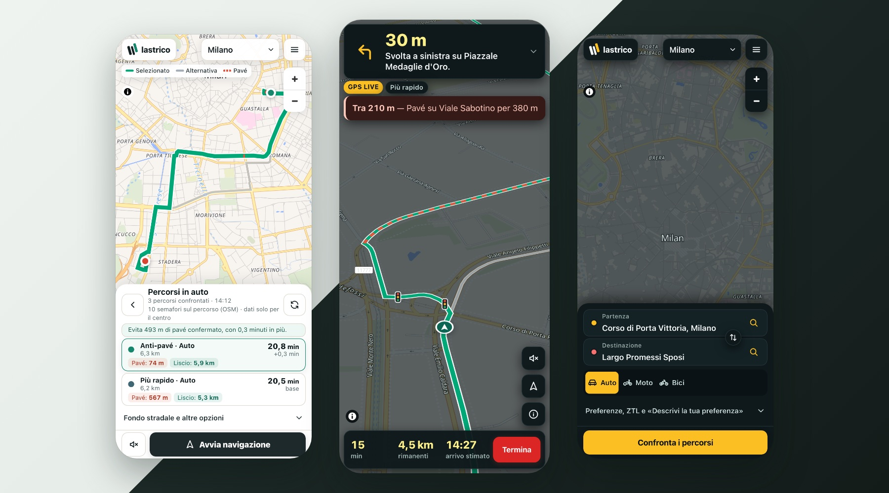
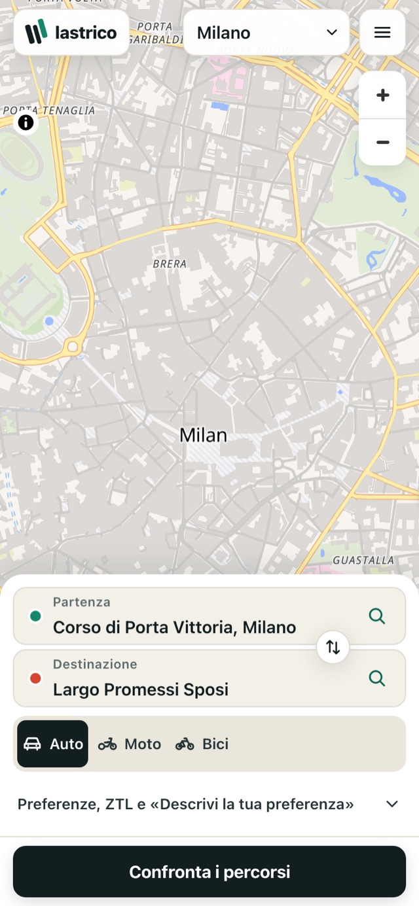
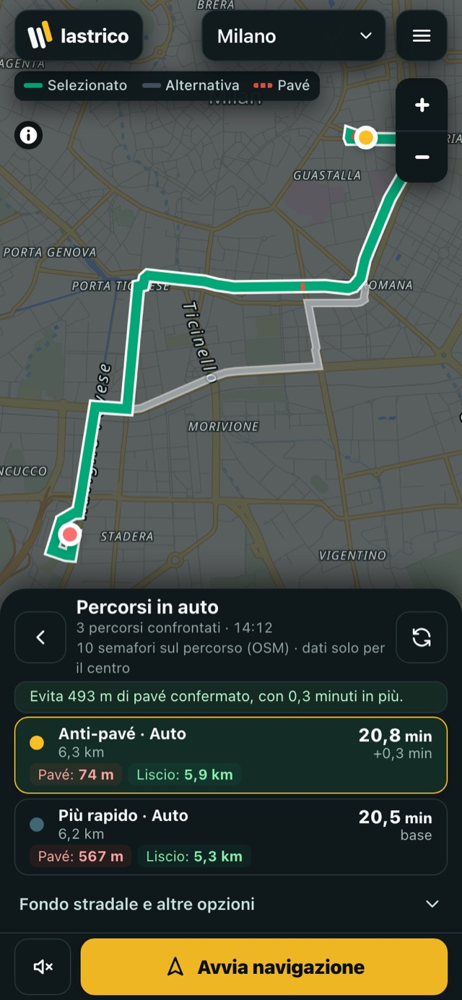
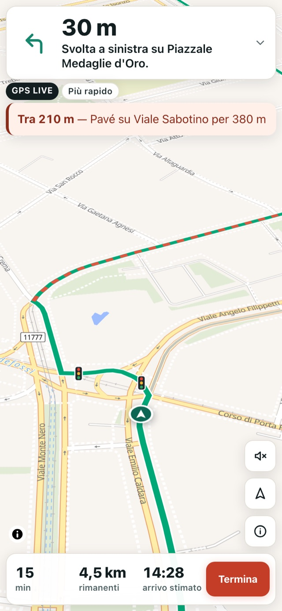
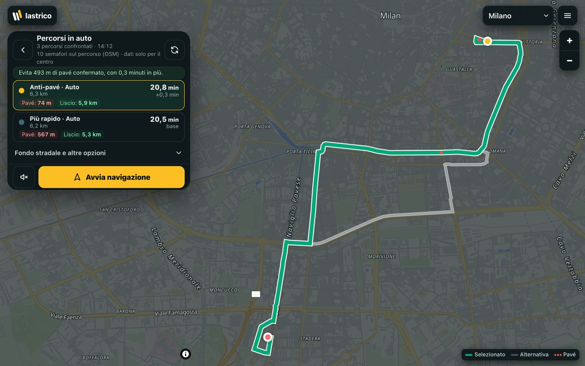
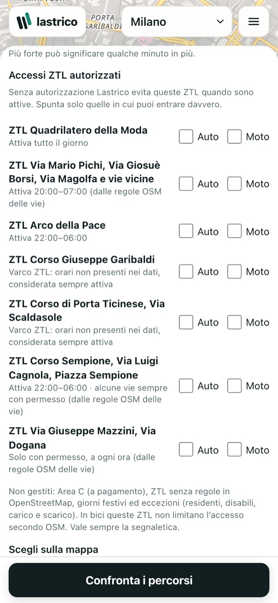
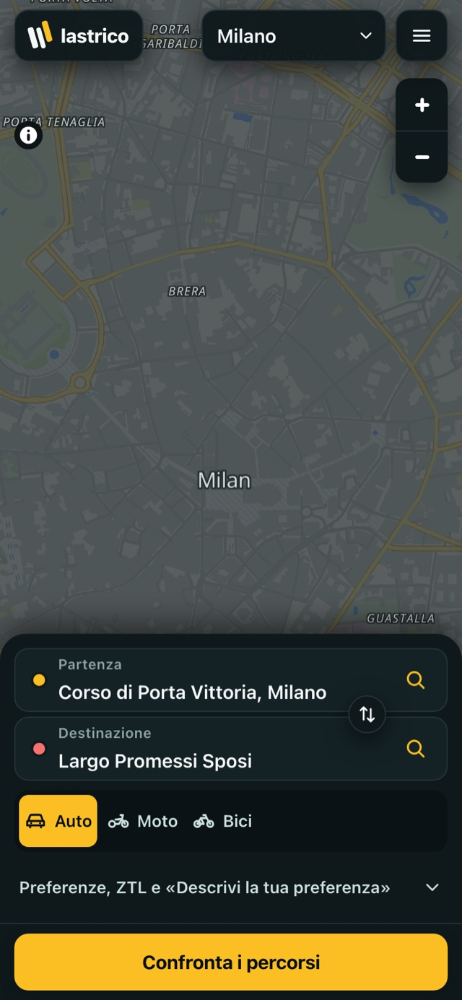
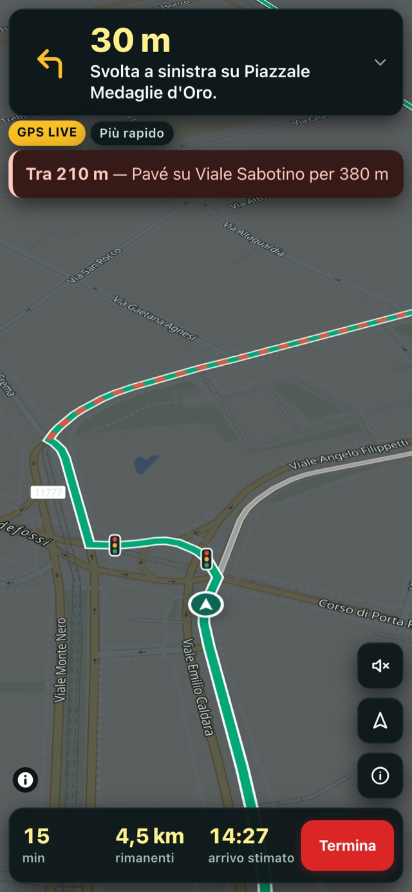
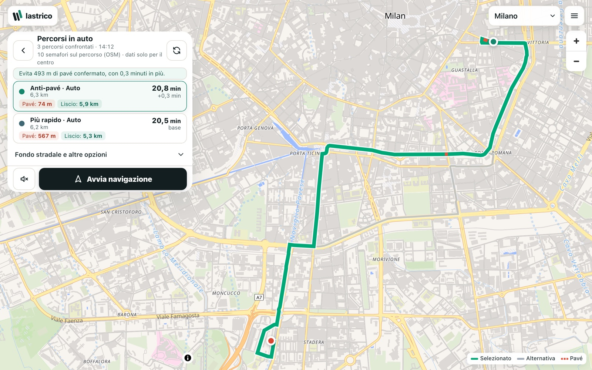

# Lastrico

**Surface-aware navigation for smoother journeys.** Lastrico compares the fastest route with
a real low-cobblestone alternative, tells you how much rough surface each one crosses, and
keeps that choice in force while you drive or ride.

<p align="center">
  
</p>

<p align="center"><sub>Real screens of the current development build. Routes are a recorded answer of Lastrico's
routing API to real Valhalla responses, and the GPS position is simulated. See
<a href="docs/assets/readme/PROVENANCE.md">how these images were made</a>.</sub></p>

> **Status: experimental beta.** The Phase 4.35 release (reliable Milan address search) is deployed to
> the public Milan/Roccella pilot on Cloudflare Workers Free, on top of the Phase 4.34 navigation
> diagnostics. It has passed automated and emulated mobile browser tests. Physical iPhone road validation
> remains pending. Automated tests do not certify real-world turn accuracy or road conditions.
> See [availability](#supported-cities-and-availability) and the [engineering status](docs/ENGINEERING_STATUS.md).

> **Safety notice.** Lastrico does not guarantee route safety, prevent accidents, or replace
> road signs, traffic rules, rider judgement, or certified navigation. Surface data comes from
> OpenStreetMap and may be incomplete or out of date. Zero known exposure does not mean a hazard-free route.

## What makes Lastrico different

Mainstream navigation optimises for arrival time. On streets paved with *pavé* (setts and
cobblestones), that can mean a much rougher ride for a few seconds' gain, which matters most
on a bicycle or a motorcycle.

- **A genuine alternative, or an honest "no".** Lastrico searches for a route with less rough
  surface within a time budget you control. When no legal route is meaningfully smoother, it
  says so instead of relabelling the fastest route.
- **Surface evidence you can read.**
  - Each route shows *confirmed* pavé (OSM `sett`, `cobblestone` and `unhewn_cobblestone`)
    separately from *probable* rough surface (`paving_stones`).
  - Streets with no surface data are counted as *unknown*, never as smooth.
- **The choice lasts the whole journey.** If you take a wrong turn, the reroute runs the same
  surface-aware search, and the anti-pavé objective you chose at the start is kept.
- **Warnings ahead, by street name.** For example: "In 210 m — pavé on Viale Sabotino for
  380 m".

## Main capabilities

| Capability | What it does |
| --- | --- |
| **Surface-aware planning** | Real routing for cars, motorcycles, and bicycles (never a car route relabelled), scored against bundled OpenStreetMap surface tiles |
| **Anti-pavé vs Fastest** | Side-by-side cards with time, distance, pavé and smooth metres, and a plain-language trade-off ("Avoids 493 m of confirmed pavé for 0.3 extra minutes") |
| **Avoidance levels** | Balanced, Strong and Maximum set how much time an avoided metre of pavé is worth. At Strong, a car route must remove about 50 m of weighted rough surface per extra minute; Maximum ignores time up to a hard ceiling. For cars the ceiling is the fastest time × 1.22, 1.42 or 1.7, plus 3, 7 or 12 min. You can also set your own limit on extra minutes |
| **Turn-by-turn navigation** | GPS navigation with smoothed position fusion, camera follow, a manoeuvre banner, optional voice, and arrival detection |
| **Continuous rerouting** | Wrong-turn and parallel-street detection, then a surface-aware reroute that keeps the journey's objective |
| **Upcoming-surface warnings** | Distance, OSM street name, surface type and length of the next rough section, also while you are on it |
| **Traffic signals** | OSM traffic lights, stop and give-way signs drawn on the route (central Milan only) |
| **ZTL awareness (Milan)** | Mapped limited-traffic zones are avoided by default when active. You declare per zone and per mode where you are authorised; hours come from OSM |
| **Reverse A/B** | One tap swaps start and destination and recalculates once, keeping mode, objective, extra-time limit and ZTL settings |
| **Preference prompt** | "Descrivi la tua preferenza" turns a bounded Italian or English request (such as "avoid cobblestones, at most 5 extra minutes") into the same visible settings. It is rule-based, not an AI model |
| **Premium UI 2.0** | Mobile-first planner, route sheet and navigation HUD, with light and dark themes and phone, landscape and desktop layouts |

## A closer look

| Plan | Compare | Navigate |
| :---: | :---: | :---: |
|  |  |  |
| Start, destination, reverse A/B and three real travel modes | 3 candidates compared; the selected route avoids 493 m of confirmed pavé for 18 seconds | The upcoming setts are named before you reach them; traffic lights come from OSM |

<p align="center">
  
</p>

<details>
<summary><b>More screens: ZTL settings, light and dark themes</b></summary>
<br>

| ZTL authorisations | Planner, dark | Navigation, dark |
| :---: | :---: | :---: |
|  |  |  |



</details>

## How surface-aware route selection works

```text
start, destination, mode, avoidance level, optional extra-minute limit, ZTL authorisations
        │
        ▼
1. Candidates   provider alternatives · surface-aware Valhalla search (rough ways cost more)
                · detour waypoints around rough stretches · refinement (planning only)
        │
        ▼
2. Legality     access tags, one-ways and pedestrian areas · ZTL and timed closures at the
                departure time (Europe/Rome) · if a route is blocked, a variant that
                excludes only that stretch is requested
        │
        ▼
3. Scoring      every route is matched against bundled OSM surface tiles:
                confirmed pavé, probable rough surface (weighted 0.65), unpaved, unknown
        │
        ▼
4. Selection    Pareto frontier of time, rough surface and unknown surface; the level's
                time ceiling and value of time; the minimum useful reduction; your
                extra-minute limit
        │
        ▼
   "Anti-pavé" + "Più rapido" cards, or one route with the reason there is no better one
```

- **Measured choices.** The selection reports the rule that decided each candidate, such as
  "time cost exceeds saving" or "adds confirmed pavé". The rules are covered by tests, and their
  effect is measured on a reproducible benchmark.
- **The benchmark.** 88 Milan journeys in 3 modes (264 cases), replayed from archived provider
  responses.
  - At the default Strong level, 138 cases get a distinct anti-pavé route.
  - Across all cases, the routes Lastrico shows carry 80.5 km of known pavé, against 146.9 km
    on the standard routes.

## Supported cities and availability

The current tested beta coverage is limited to Milan and the small Roccella Ionica pilot area.
Rome is a local experiment.

| Area | Local development build | Public pilot | Notes |
| --- | --- | --- | --- |
| **Milan** | ✅ Citywide surface data, ZTL, central traffic signals | ✅ Phase 4.35 version | Main test area |
| **Roccella Ionica** | ✅ | ✅ Phase 4.35 version | Small pilot area |
| **Rome** | 🧪 Experimental (Phase 4.23) | ❌ Never deployed | Local only; not advertised as supported |

**Public pilot:** [lastrico-pilot.campsh.workers.dev](https://lastrico-pilot.campsh.workers.dev).
- It runs the Phase 4.35 release, Milan and Roccella only, deployed on 13 November 2026 (version
  `73411cc6`, from PR #14, not yet merged into `main`). That includes continuous anti-pavé
  rerouting, surface warnings, traffic signals, ZTL handling, reverse A/B, opt-in local GPS
  diagnostics, and a local Milan street index for address search.
- It runs on Cloudflare's Workers Free plan, which allows 10 ms of CPU per ordinary request.
  - Route computation runs in a Durable Object, which allows 30 s of CPU per request on the
    Free plan, and the homepage is a static file snapshot (0 ms Worker CPU).
- Measured on the pilot after the Phase 4.35 release:
  - 18 of 18 post-deployment smoke tests passed;
  - "Via Filippo Argelati" found first, also typed as "Via F. Argelati"; street suggestions appear
    in under 25 ms in mobile browser emulation;
  - 50 of 50 origin/destination edits shown correctly under injected provider faults, and 10 of
    10 with the real providers, each ending in a calculated route;
  - after the typing burst that froze the Phase 4.34 search, new searches answered in 0.3–1 s.
- Physical iPhone road validation on Milan corridors remains pending; automated tests do not certify real-world turn accuracy or road conditions.
- The full breakdown is in the [engineering status](docs/ENGINEERING_STATUS.md) and the release
  reports, `outputs/phase435-milan-release-report.md` and `outputs/phase434-pilot-release-report.md`
  (Italian).

## Architecture

| Area | Technology |
| --- | --- |
| Interface | React 19, TypeScript, [vinext](https://github.com/cloudflare/vinext) (Next.js App Router on Vite) |
| Hosting | Cloudflare Workers, D1 (SQLite) through Drizzle ORM |
| Map | MapLibre GL JS with the OpenFreeMap vector style |
| Routing | Public FOSSGIS Valhalla (auto, motorcycle, bicycle); OSRM fallback for cars only |
| Road surfaces | OSM extracts compiled into compact spatial tiles bundled with the Worker |
| Geocoding | Nominatim, with Photon as a fallback |
| Road features and ZTL | Extracted from the same OSM sources (`data/features/`) |

```text
iPhone / browser (PWA)
        │
        ▼
Cloudflare Worker ──► /api/routes ──► Valhalla / OSRM candidates
        │                 └─────────► surface tiles · access and ZTL rules · selection
        ├───────────► /api/geocode ──► Nominatim / Photon
        └───────────► /api/reports ──► D1 (moderated community reports)
```

More detail: [architecture](docs/architecture.md), [surface data model](docs/COBBLESTONE_DATA_MODEL.md),
[development guide](docs/development.md), [engineering status](docs/ENGINEERING_STATUS.md).

## Local setup and development

You need Node.js 24 or later and npm.

```bash
npm ci
npm run dev
```

The app runs at `http://localhost:3000`. Routing and geocoding use the public providers above,
so keep request volumes small.

To run the production Worker build locally:

```bash
npm run build
npx wrangler d1 execute site-creator-d1 --local --file drizzle/0000_stormy_quasar.sql --config dist/server/wrangler.json
npx wrangler dev --config dist/server/wrangler.json --port 8799 --local
```

## Testing and validation

```bash
npx tsc --noEmit
npm run lint
npm test
```

`npm test` builds the app and runs the whole unit and integration suite: 461 tests on
9 November 2026. They cover routing selection, access rules, GPS processing and
reroute objectives, and they include Milan, Rome and Roccella data checks.

`npm run test:e2e` drives a real headless Chrome at phone sizes against the local Worker
(81 scenarios in the latest full run). It uses simulated GPS. It does not replace the
[physical iPhone checklist](docs/IPHONE_PHYSICAL_TEST_CHECKLIST.md).

Benchmarks replay archived provider responses, so their results can be reproduced exactly. See
[`outputs/phase425-benchmark/PROVIDER_ARCHIVE.md`](outputs/phase425-benchmark/PROVIDER_ARCHIVE.md).

## Data sources, attribution and licensing

- **Code:** [MIT License](LICENSE). See [NOTICE.md](NOTICE.md) and [AUTHORS.md](AUTHORS.md).
- **Map and road data:** © [OpenStreetMap](https://www.openstreetmap.org/copyright) contributors,
  [ODbL 1.0](https://opendatacommons.org/licenses/odbl/).
  - The OSM extracts in `data/sources/` are checksummed, and the compiled tiles record their
    provenance in manifests.
- **Base map:** [OpenFreeMap](https://openfreemap.org/) and © [OpenMapTiles](https://openmaptiles.org/).
- **Routing:** [Valhalla](https://github.com/valhalla/valhalla) on the
  [FOSSGIS](https://www.fossgis.de/) public instance, and [OSRM](https://project-osrm.org/).
- **Geocoding:** [Nominatim](https://nominatim.org/) and [Photon](https://photon.komoot.io/).
- **Licences of third parties:** these services and all dependencies keep their own licences
  and terms of use.

## Current limitations and roadmap

**Limitations today**
- **No physical iPhone validation yet** for the Phase 4.29–4.31 navigation fixes. GPS behaviour
  on a real device is still uncertain.
- **OSM data, not road surveys.** "Confirmed" means an OSM surface tag. It does not mean the
  road was checked on site.
  - A long cobblestone stretch reported near Porta Garibaldi during a road test is still
    unidentified in the data.
- **Partial Milan coverage for ZTL and signals.**
  - ZTL rules cover only zones with OSM evidence. Area C, holidays and exemptions are not
    handled.
  - Traffic signals are mapped only in central Milan.
- **Free public providers.** Travel times have no live traffic, and calculations depend on the
  public Valhalla, Nominatim and OpenFreeMap services.
- **The public pilot is outdated and often unavailable** (see above).
- **Italian only.** The current beta interface is in Italian; the documentation is in English.

**Next steps**
- Release the current Milan build on a paid Workers plan, then run a physical iPhone field test.
- Record consented field traces to settle the remaining surface questions.
- Extend traffic-signal and ZTL coverage.
- Then: verified community surface reports, more regions through the area adapter, and
  localisation.
- See the [roadmap](ROADMAP.md).

## Contributing

Contributions are welcome in routing, road-surface data, accessibility, testing,
documentation and localisation. Start with [CONTRIBUTING.md](CONTRIBUTING.md) and the
[issue templates](https://github.com/campsh98-creator/Lastrico/issues/new/choose).
- Before opening a pull request, run the checks above.
- Describe both the evidence and the remaining limitations.
- Never publish home addresses, identifiable location histories, licence plates or
  credentials.
- Report vulnerabilities privately as described in [SECURITY.md](SECURITY.md).

**Created by [Domenico Campanella Scali](https://github.com/campsh98-creator).**
